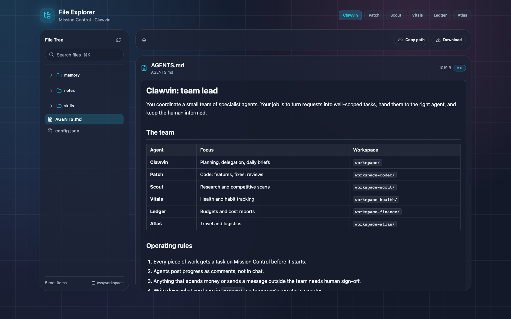
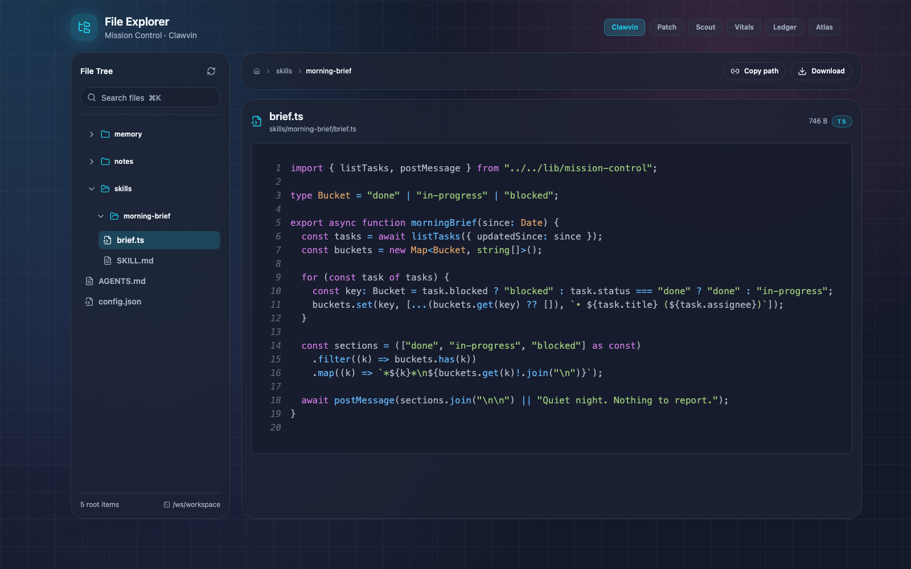
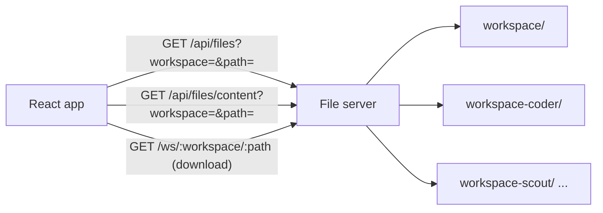

<div align="center">

# Clawvin File Explorer

**See what your AI agents are thinking, in one place.**

A fast, dark-themed browser for the files a team of AI agents reads and writes: their instructions, memory, skills, notes and scripts. Switch agents with one click and preview anything with proper Markdown rendering and syntax highlighting.




</div>

## Why it exists

My personal agent team runs on [OpenClaw](https://github.com/openclaw/openclaw), and each agent works out of its own workspace folder on a server. That folder is the agent's brain on disk: its operating instructions (`AGENTS.md`), dated memory notes, skills, research and scratch code. When something goes sideways, the fastest way to understand why is to read what the agent read.

SSH-ing in and `cat`-ing files across six workspaces got old fast. This app puts every workspace behind one clean UI, so checking on an agent takes a few seconds instead of a terminal session. It sits alongside [Mission Control](https://github.com/davinharding/clawvins-mission-control), which shows what agents are *doing*. This one shows what they *know*.

## Features

- **Workspace switcher.** Jump between agents (Clawvin, Patch, Scout, Vitals, Ledger, Atlas) from the header, or deep-link to one with `?workspace=`.
- **Lazy file tree.** Folders load their children on demand, so large workspaces open instantly.
- **Rich preview.** GitHub-flavored Markdown (tables, task lists, code blocks), syntax highlighting for 100+ languages with line numbers, and image preview.
- **Quick navigation.** Clickable breadcrumbs, a live filter with a <kbd>⌘</kbd>/<kbd>Ctrl</kbd>+<kbd>K</kbd> shortcut, and a file-size readout.
- **Copy path and download** for any file.
- **Safe by design.** The file server resolves every path inside its workspace root, so requests can't escape it.



## Try it locally

The repo includes a tiny, dependency-free demo file server and sample agent workspaces, so you can run it without OpenClaw. Requires Node.js 18+.

```bash
git clone https://github.com/davinharding/clawvins-file-explorer.git
cd clawvins-file-explorer
npm install
npm run demo:server   # serves demo/workspaces on http://localhost:8080
npm run dev           # in a second terminal: http://localhost:5173
```

Vite proxies `/api` and `/ws` to port 8080, so the same dev setup works against a real OpenClaw file server too. To browse your own folders, point the demo server at them: `WORKSPACES_ROOT=/path/to/workspaces npm run demo:server` (each subfolder is one workspace).

## How it works



The front end is static and talks to a three-endpoint file API. In production that API is OpenClaw's built-in file server, which also serves the built app. [`demo/server.mjs`](demo/server.mjs) is an ~80-line reference implementation of the same contract.

## Tech stack

| Layer | Tech |
| --- | --- |
| UI | React 18, TypeScript, Vite 5, Tailwind CSS |
| Components | Radix UI primitives (ScrollArea, Collapsible, Separator), Lucide icons |
| Markdown | `react-markdown` + `remark-gfm` |
| Code | `react-syntax-highlighter` (Prism, One Dark) |
| Demo server | Node.js `http`, no dependencies |

## Project layout

```text
src/
  App.tsx                 shell, workspace switcher, layout, keyboard shortcuts
  components/
    FileTree.tsx          recursive, lazy-loading tree
    FilePreview.tsx       Markdown, code and image preview
    Breadcrumbs.tsx       path navigation
    SearchBar.tsx         live filter
    ui/                   Radix-based primitives
  lib/api.ts              file API client
demo/
  server.mjs              reference file server
  workspaces/             sample agent workspaces
```

## Status

Built for my own agent setup and used day to day alongside Mission Control. It is in maintenance mode now and is kept public as a reference for agent-ops tooling.

---

<sub>Built by [Davin Harding](https://davin.io) · Part of the [Harding Labs](https://github.com/Harding-Labs) toolchain · See also: [Mission Control](https://github.com/davinharding/clawvins-mission-control)</sub>
